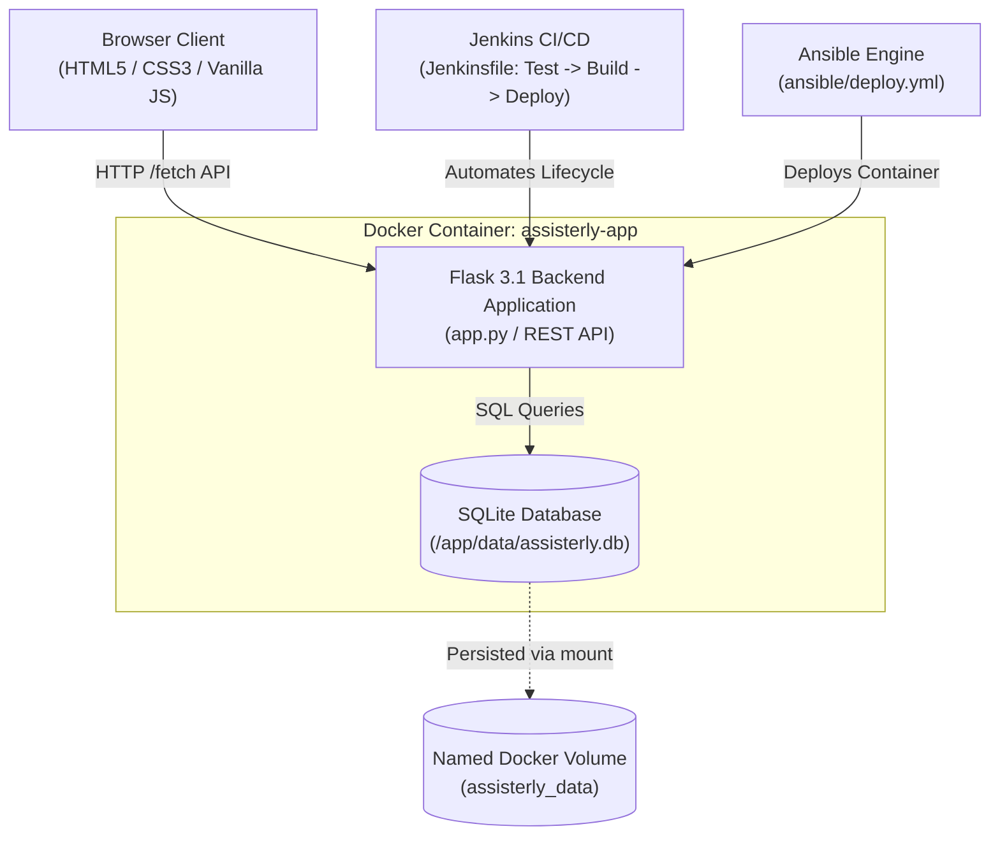

# Assisterly — Full-Stack Caregiver Platform & DevOps Lab Project

[](https://www.python.org/downloads/)
[](https://flask.palletsprojects.com/)
[](https://www.sqlite.org/)
[](https://www.docker.com/)
[-brightgreen.svg)](https://docs.pytest.org/)
[](https://www.jenkins.io/)
[](https://www.ansible.com/)

**Assisterly** is an end-to-end caregiver coordination web application and DevOps pipeline created for the **DevOps Lab Final Project** (Register No: **23IT721**). It connects families with background-verified caregivers, provides real-time shift task tracking with checklist completion persistence, caregiver registration, and complete DevOps automation including Docker containerization, Jenkins CI/CD pipeline, and Ansible automated deployment.

---

## Table of Contents

1. [Project Overview & Architecture](#project-overview--architecture)
2. [Repository Structure](#repository-structure)
3. [Prerequisites](#prerequisites)
4. [Local Installation & Startup](#local-installation--startup)
5. [Database Initialization & Seeding](#database-initialization--seeding)
6. [Automated Testing with Pytest](#automated-testing-with-pytest)
7. [Docker & Docker Compose](#docker--docker-compose)
8. [Verifying Database Persistence](#verifying-database-persistence)
9. [Jenkins CI/CD Pipeline](#jenkins-cicd-pipeline)
10. [Ansible Deployment Automation](#ansible-deployment-automation)
11. [REST API Documentation & Examples](#rest-api-documentation--examples)
12. [DevOps Lab Demonstration Sequence](#devops-lab-demonstration-sequence)
13. [Troubleshooting & FAQs](#troubleshooting--faqs)

---

## Project Overview & Architecture

Assisterly integrates a modern vanilla HTML/CSS/JavaScript frontend with a modular Flask backend and SQLite database layer.



### Key Technical Decisions
* **Same-Origin Serving:** Flask serves both the static frontend files (`index.html`, `directory.html`, `dashboard.html`, `details.html`, styles, and scripts) and the `/api/*` endpoints, eliminating unnecessary cross-origin resource sharing (CORS) complexity in production and Docker.
* **Persistent SQLite:** Configured via `DATABASE_PATH` environment variable. Defaults to `data/assisterly.db` locally and mounts to the named Docker volume `assisterly_data:/app/data` in containerized environments.
* **Security & Hygiene:** Runs as non-root `appuser` (UID 1000) inside Docker; sensitive files (`.env`, database files, `.git`) are blocked by server-side routing guards.
* **Idempotent Seeding:** `db.py` and `seed.py` initialize tables and synthetic demo data if the database is empty, preventing accidental deletion of records on server restart.

---

## Repository Structure

```
Assisterly_devops/
├── app.py                   # Flask application factory and REST API endpoints
├── db.py                    # SQLite connection pooling, schema, and seed logic
├── seed.py                  # Standalone CLI database seeder
├── requirements.txt         # Core Python dependencies
├── pytest.ini               # Pytest configuration and path settings
├── Dockerfile               # Multi-stage production container with healthcheck
├── docker-compose.yml       # Docker Compose service definition with persistent volume
├── Jenkinsfile              # Declarative CI/CD pipeline (Test -> Build -> Deploy)
├── .env.example             # Safe environment configuration template
├── .gitignore               # Python, SQLite, OS, and virtual environment excludes
├── .dockerignore             # Production build exclusions
├── ansible/
│   ├── inventory.ini        # Ansible target inventory and variables
│   └── deploy.yml           # Ansible idempotent deployment playbook
├── tests/
│   ├── conftest.py          # Pytest fixtures with isolated temporary database
│   ├── test_health.py       # Healthcheck API tests
│   ├── test_caregivers.py   # Caregivers listing, search, creation, booking tests
│   ├── test_shifts.py       # Shifts retrieval, checklist update persistence tests
│   └── test_frontend.py     # Static asset serving and security guard tests
├── index.html               # Main dashboard and booking portal
├── script.js                # Main dashboard interactivity and registration fetch()
├── directory.html           # Caregiver directory page
├── directory.js             # Directory filtering and booking fetch()
├── dashboard.html           # Shift dashboard and task checklist
├── dashboard.js             # Checklist checkbox toggle with PUT /api/checklist fetch()
├── details.html             # Registration confirmation summary page
├── details.js               # Authoritative caregiver profile fetch()
├── style.css                # Primary platform stylesheet
└── assignment1.css          # Event handling stylesheet
```

---

## Prerequisites

Ensure the following tools are installed on your host machine:

* **Python 3.10+** (Python 3.11, 3.12, or 3.13)
* **Docker & Docker Compose** (Docker Desktop on Windows/macOS or Docker Engine on Linux)
* **Git**
* *(Optional)* **WSL 2 / Linux** for running Ansible playbooks locally
* *(Optional)* **Jenkins 2.400+** for running the automated pipeline

---

## Local Installation & Startup

### 1. Clone the repository and enter the directory
```bash
git clone <repository-url>
cd Assisterly_devops
```

### 2. Set up Python virtual environment
**On Windows (PowerShell):**
```powershell
python -m venv .venv
.venv\Scripts\activate
pip install -r requirements.txt
```

**On Linux / macOS:**
```bash
python3 -m venv .venv
source .venv/bin/activate
pip install -r requirements.txt
```

### 3. Configure environment variables
Copy `.env.example` to `.env`:
```bash
cp .env.example .env
```

### 4. Run the application
```bash
python app.py
```
The server will start on `http://127.0.0.1:5000`. Open your browser to explore:
* **Home Dashboard:** [http://127.0.0.1:5000/](http://127.0.0.1:5000/)
* **Caregiver Directory:** [http://127.0.0.1:5000/directory.html](http://127.0.0.1:5000/directory.html)
* **Shift Task Dashboard:** [http://127.0.0.1:5000/dashboard.html](http://127.0.0.1:5000/dashboard.html)
* **Health API Check:** [http://127.0.0.1:5000/api/health](http://127.0.0.1:5000/api/health)

---

## Database Initialization & Seeding

The SQLite database automatically initializes and seeds on first application run. To manually initialize or reset demo records:

```bash
# Initialize and seed if database is empty
python seed.py

# Force reset and re-seed all tables
python seed.py --force
```

### Data Schema Overview
* `caregivers`: Contains background-verified caregivers, ratings, rates, bios, skills, and contact information.
* `shifts`: Contains scheduled patient care shifts.
* `shift_tasks`: Contains individual checklist tasks linked to shifts with persistent `done` boolean flag.
* `bookings`: Contains booked caregiver shift requests.

---

## Automated Testing with Pytest

Assisterly includes an automated test suite of **20 tests** covering health, caregivers CRUD, validation rules, shift checklist persistence, and security headers. All tests run against an **isolated temporary database** created during test execution, guaranteeing development data is never modified.

### Run the test suite:
```bash
pytest -v
```

### Expected Output:
```
tests/test_caregivers.py::test_list_caregivers PASSED                    [  5%]
tests/test_caregivers.py::test_filter_caregivers_by_specialty PASSED     [ 10%]
tests/test_caregivers.py::test_filter_caregivers_by_search PASSED        [ 15%]
tests/test_caregivers.py::test_get_existing_caregiver PASSED             [ 20%]
tests/test_caregivers.py::test_get_nonexistent_caregiver PASSED          [ 25%]
tests/test_caregivers.py::test_create_caregiver_success PASSED           [ 30%]
tests/test_caregivers.py::test_create_caregiver_validation_failures PASSED [ 35%]
tests/test_caregivers.py::test_update_caregiver PASSED                   [ 40%]
tests/test_caregivers.py::test_book_caregiver PASSED                     [ 45%]
tests/test_frontend.py::test_serve_index_html PASSED                     [ 50%]
tests/test_frontend.py::test_serve_directory_page PASSED                 [ 55%]
tests/test_frontend.py::test_serve_dashboard_page PASSED                 [ 60%]
tests/test_frontend.py::test_serve_details_page PASSED                   [ 65%]
tests/test_frontend.py::test_serve_css_and_js_assets PASSED              [ 70%]
tests/test_frontend.py::test_forbidden_sensitive_files PASSED            [ 75%]
tests/test_health.py::test_health_check_success PASSED                   [ 80%]
tests/test_shifts.py::test_list_shifts PASSED                            [ 85%]
tests/test_shifts.py::test_update_checklist_item_persistence PASSED      [ 90%]
tests/test_shifts.py::test_create_shift_and_checklist_item PASSED        [ 95%]
tests/test_shifts.py::test_nonexistent_checklist_item PASSED             [100%]

============================= 20 passed in 0.72s ==============================
```

---

## Docker & Docker Compose

### 1. Build and Run with Docker Compose
```bash
# Build image and start in background
docker compose up --build -d

# Check running container status
docker compose ps

# View container logs
docker compose logs -f
```

### 2. Verify Container Health
```bash
curl http://localhost:5000/api/health
```

### 3. Stop Container
```bash
docker compose down
```

---

## Verifying Database Persistence

The Docker container stores the SQLite database in `/app/data/assisterly.db`, which is mounted to the named volume `assisterly_data`. This ensures data survives container recreation.

### Persistence Test Procedure:
1. Start the container:
   ```bash
   docker compose up -d
   ```
2. Mark a checklist item as completed via API or browser on `http://localhost:5000/dashboard.html`:
   ```bash
   curl -X PUT http://localhost:5000/api/checklist/3 \
     -H "Content-Type: application/json" \
     -d '{"done": true}'
   ```
3. Re-create the container:
   ```bash
   docker compose down
   docker compose up -d
   ```
4. Query the shift tasks again:
   ```bash
   curl -s http://localhost:5000/api/shifts/shift-1
   ```
5. Observe that task `3` (`Prepare and serve breakfast`) is still `done: true`. The change survived container recreation!

---

## Jenkins CI/CD Pipeline

The included `Jenkinsfile` defines a cross-platform declarative pipeline with 5 stages:

1. **Checkout:** Checks out source code from Git repository.
2. **Install Dependencies:** Creates virtualenv and installs dependencies from `requirements.txt`.
3. **Run Automated Tests:** Executes `pytest -v --junitxml=test-results.xml`. If any test fails, the pipeline halts immediately, preventing faulty code from being built or deployed.
4. **Build Docker Image:** Builds the `assisterly:latest` Docker image.
5. **Deploy Container:** Restarts the container with persistent storage and verifies `/api/health`.

### Jenkins Setup Steps:
1. Open Jenkins and create a **New Item** &rarr; select **Pipeline**.
2. Under **Pipeline Definition**, select **Pipeline script from SCM**.
3. Set SCM to **Git** and enter repository URL.
4. Set Script Path to `Jenkinsfile`.
5. Click **Save** &rarr; **Build Now**.

---

## Ansible Deployment Automation

Ansible automates deployment idempotently, configuring persistent volumes, building/pulling images, running containers, and verifying health.

### Prerequisites:
* Ansible installed on Linux/WSL (`sudo apt-get install ansible`)

### Running the Deployment Playbook:
**From WSL or Linux:**
```bash
cd ansible
ansible-playbook -i inventory.ini deploy.yml
```

### Verify Playbook Syntax:
```bash
ansible-playbook -i ansible/inventory.ini ansible/deploy.yml --syntax-check
```

---

## REST API Documentation & Examples

| Method | Endpoint | Description | Status Codes |
|---|---|---|---|
| `GET` | `/api/health` | System health check and record counters | `200`, `500` |
| `GET` | `/api/caregivers` | List caregivers with optional search/filter | `200` |
| `GET` | `/api/caregivers/<id>` | Retrieve single caregiver profile | `200`, `404` |
| `POST` | `/api/caregivers` | Register new caregiver (validates inputs) | `201`, `400` |
| `PUT` | `/api/caregivers/<id>` | Update caregiver profile | `200`, `400`, `404` |
| `POST` | `/api/caregivers/<id>/book` | Book a caregiver | `201`, `404` |
| `GET` | `/api/bookings` | Retrieve all caregiver bookings | `200` |
| `GET` | `/api/shifts` | Retrieve all scheduled shifts with checklist tasks | `200` |
| `GET` | `/api/shifts/<id>` | Retrieve single shift | `200`, `404` |
| `POST` | `/api/shifts` | Create new shift | `201`, `400` |
| `GET` | `/api/shifts/<id>/checklist`| Retrieve checklist items for a shift | `200`, `404` |
| `PUT` | `/api/checklist/<task_id>` | Toggle/update task completion status | `200`, `400`, `404` |

### Sample cURL Requests

#### 1. System Health Check
```bash
curl -X GET http://localhost:5000/api/health
```
Response:
```json
{
  "status": "healthy",
  "database": "connected",
  "caregivers_count": 8,
  "shifts_count": 3,
  "timestamp": "2026-10-13T15:35:24.867202+00:00",
  "version": "1.0.0"
}
```

#### 2. Search & Filter Caregivers
```bash
curl -X GET "http://localhost:5000/api/caregivers?specialty=Dementia+Care"
```

#### 3. Register a New Caregiver
```bash
curl -X POST http://localhost:5000/api/caregivers \
  -H "Content-Type: application/json" \
  -d '{
    "fullName": "Meera Krishnan",
    "email": "meera.krishnan@assisterly.com",
    "phone": "9876543220",
    "specialty": "Elderly Care",
    "availability": "Available Now",
    "rate": 42.0,
    "address": "18 Gandhi Road, Coimbatore",
    "skills": "nursing,firstaid"
  }'
```

#### 4. Update Shift Checklist Task
```bash
curl -X PUT http://localhost:5000/api/checklist/3 \
  -H "Content-Type: application/json" \
  -d '{"done": true}'
```

---

## DevOps Lab Demonstration Sequence

Follow this step-by-step checklist during lab evaluation:

1. **Demonstrate Automated Testing:**
   ```bash
   pytest -v
   ```
   Show all 20 tests passing in less than 1 second.
2. **Start the Application:**
   ```bash
   python app.py
   # Or with Docker: docker compose up -d
   ```
3. **Verify Health Endpoint:**
   Show [http://localhost:5000/api/health](http://localhost:5000/api/health) returning `200 OK` with database connection and counts.
4. **Demonstrate Caregiver Directory:**
   Open [http://localhost:5000/directory.html](http://localhost:5000/directory.html).
   * Demonstrate searching and filtering by specialty.
   * Click **Book Now** on a caregiver card and observe the counter incrementing and persisting.
5. **Demonstrate Shift Checklist Persistence:**
   Open [http://localhost:5000/dashboard.html](http://localhost:5000/dashboard.html).
   * Check off a task in a shift card. Observe progress percentage updating.
   * Refresh browser tab (`F5`). Observe the checkbox remains checked and percentage persists!
6. **Demonstrate Caregiver Registration Form:**
   Open [http://localhost:5000/#register](http://localhost:5000/#register).
   * Submit the registration form.
   * View the newly created profile on `details.html`.
   * Open `directory.html` and show the new caregiver present in the list.
7. **Demonstrate DevOps Automation:**
   * Show `Dockerfile`, `docker-compose.yml`, `Jenkinsfile`, and `ansible/deploy.yml`.
   * Run Ansible syntax check:
     ```bash
     wsl -d Ubuntu ansible-playbook -i /mnt/c/College/SEMVII/Assisterly_devops/ansible/inventory.ini /mnt/c/College/SEMVII/Assisterly_devops/ansible/deploy.yml --syntax-check
     ```

---

## Troubleshooting & FAQs

* **Port 5000 is already in use:**
  Change `PORT` in `.env` or run with:
  ```bash
  PORT=5001 python app.py
  ```
* **Docker Desktop not connected:**
  Ensure Docker Desktop is running before issuing Docker commands. If on Windows, start Docker Desktop from the Start menu and wait for the system tray icon to turn solid white.
* **Database locked error in SQLite:**
  SQLite handles concurrent connections via write-ahead logging. If testing multiple processes, ensure previous server instances are stopped.
* **Resetting Database to Fresh State:**
  Run `python seed.py --force` to re-seed the SQLite database with initial synthetic demo records.

---

## Author & Academic Information

* **Developer:** Varun
* **Register Number:** 23IT721 (2303717620521057)
* **Course:** DevOps Laboratory / Full Stack Development
* **Institution:** Sri Krishna College of Technology (SKCT), Coimbatore
* **Academic Year:** 2026
